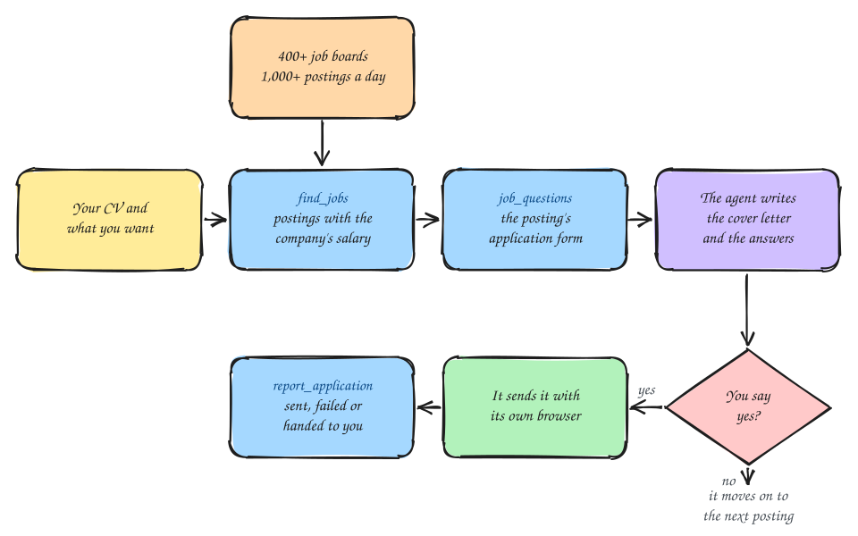

<p align="center"></p>

<h1 align="center">Apply to thousands of tech jobs with your agent</h1>

<p align="center">Have your agent apply for you. Free.</p>

<h2 align="center"><a href="https://spanishtoptechcompanies.com/en/">spanishtoptechcompanies.com</a></h2>

<p align="center"><a href="./README.md">🇪🇸</a> / <b>🇬🇧</b></p>

## Connect it

Paste this link into your agent's chat and it connects itself.

```text
https://spanishtoptechcompanies.com/mcp
```

No sign-up, no keys, nothing to install. It works with any agent that supports MCP: Claude Code, Codex, Cursor, Hermes, Grok, Instinct and the rest.

One person maintains it. If it is useful to you, a star gets it found by more people looking for work in Spain.

## How it works

Your agent does the work, you decide.

1. **Connect it.** One link in your agent. No sign-up, no keys, nothing to install.
2. **Ask it for jobs.** “Remote backend above 60k”. It searches today's postings and tells you what each company pays.
3. **Apply with your yes.** It fills in the form from your CV, asks you what it does not know and sends only when you approve.

<p align="center"></p>

For it to apply well, give it once your CV, where and how you want to work, the salary you ask for and your work authorization. After that one sentence is enough:

> Apply to 5 backend openings in Barcelona.

> Apply to the remote openings I can do from Spain that pay 60,000 € or more.



## Questions

<details>
<summary>Is it free?</summary>

Yes. No sign-up, no keys and nothing to install: it is a link you add to your agent.
</details>

<details>
<summary>Which roles are there postings for?</summary>

Every role the companies have open: engineering, data, product, design, sales, marketing and the rest.
</details>

<details>
<summary>Where do the postings come from?</summary>

From the companies' own job boards, more than 400, read every day: roles in Spain or remote ones open to Spain or Europe. Those you have already seen or applied to do not come back.
</details>

<details>
<summary>Where do the salaries come from?</summary>

From [Levels.fyi](https://www.levels.fyi), and only from people whose location is in Spain. Every posting carries the company's median base salary for that role and how many people it comes from. The rules are in [METHODOLOGY.md](METHODOLOGY.md#the-website-and-the-mcp-server).
</details>

<details>
<summary>Does it send applications without asking me?</summary>

No. It shows you the whole application and sends it only when you say yes. Privacy consents are yours to accept.
</details>

<details>
<summary>Does it make up answers?</summary>

No. It fills in what your CV says and asks you for the rest, all in one message. Opinion questions are yours to answer.
</details>

<details>
<summary>What data of mine is stored?</summary>

None. Your CV, your answers and your applications stay with your agent, in its memory or in a file such as `~/job-search.md`. Each call is only counted as an anonymous statistic.
</details>

<details>
<summary>What if my agent has no browser?</summary>

It sets one up when it is time to send and runs it in the background, with no window. Only if it cannot, it gives you the link and the answers to send it yourself. If a form asks for a CAPTCHA, it hands you the page. If a company emails a code, it reads it from your mail if you connect it, or asks you.
</details>

<details>
<summary>How do I add my salary?</summary>

Submit it to [Levels.fyi](https://www.levels.fyi/salaries/add). It is anonymous and counts from the next refresh, every week. If you know first-hand what a company pays, or have a written offer, open an [issue](../../issues/new?template=update-band.yml).
</details>

## For developers

<details>
<summary>MCP tools</summary>

The server is called `tech-pay-spain`. Your agent picks the tool, you do not have to name it.

- `find_jobs` searches the day's open postings by text, role, region, workplace, level, years of experience, company and minimum salary. When nothing matches, it says which filter is in the way and suggests the closest ones.
- `job_questions` reads a posting's application form live: each question, whether it is required and whether it is yours or the agent's to answer.
- `application_guide` gives the procedure for applying on someone's behalf and the template for the notes the agent keeps.
- `report_application` records how each application went and what sending it took. It carries nothing about you.
- `salary_stats` gives the median base salary, the range and the total for a role, region and experience.
- `top_companies` lists the best-paying companies for a role, region and experience.
- `company_salaries` gives what one company pays, overall and by role, region or experience.
- `list_filters` lists roles, regions, experience buckets and the data date.

</details>

<details>
<summary>Server, data and code</summary>

- Streamable HTTP at `https://spanishtoptechcompanies.com/mcp`, no authentication, CORS open.
- The same server over stdio, with Node 22 or later and no dependencies: `node scripts/mcp-stdio.mjs`.
- The data in [data.json](https://spanishtoptechcompanies.com/api/v1/data.json), the postings in [jobs.json](https://spanishtoptechcompanies.com/api/v1/jobs.json) and a summary in [llms.txt](https://spanishtoptechcompanies.com/llms.txt).
- A [skill for agents](skills/tech-pay-spain/SKILL.md) on how to read the figures.

</details>

## Contributing

Pull requests are welcome, and so is an [issue](../../issues/new/choose) if you would rather talk it over first.

- [CONTRIBUTING.md](CONTRIBUTING.md): how to add a salary or a company and how to open a pull request.
- [Code of conduct](CODE_OF_CONDUCT.md): what is expected of everyone taking part.
- [SECURITY.md](SECURITY.md): how to report a security problem.
- [METHODOLOGY.md](METHODOLOGY.md) explains the rules and [docs/CONTEXT.md](docs/CONTEXT.md) why the code is the way it is.

## Licence and disclaimer

The code is [MIT](LICENSE) and the data in `data/` is [CC BY-SA 4.0](LICENSE-DATA). Salaries are read from [Levels.fyi](https://www.levels.fyi) and remain subject to its terms.

> Data source: Levels.fyi (https://www.levels.fyi)

An independent project, not affiliated with Levels.fyi or with any of the companies. The figures summarize salaries other people have reported. They can be incomplete, out of date or wrong, and they are not offers or financial or legal advice. If you want something removed or corrected, about a company or about you, open an [issue](../../issues/new/choose) or write to ugartep117@gmail.com. Who is behind it and what data is processed: [legal notice and privacy](https://spanishtoptechcompanies.com/en/legal/).
