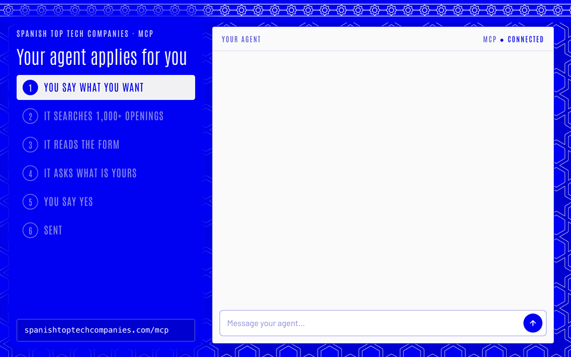
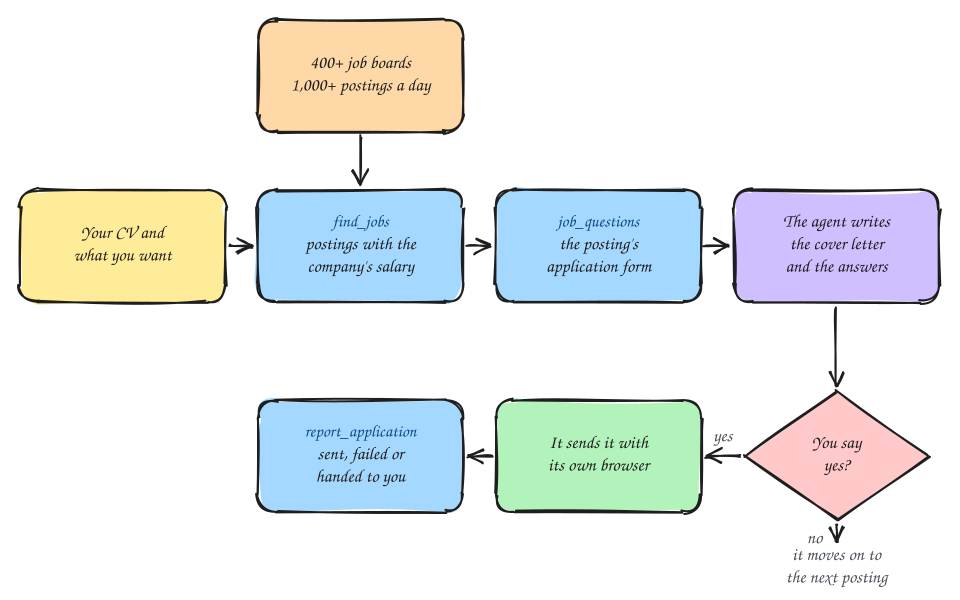

# Spanish Top Tech Companies: MCP for tech jobs and salaries in Spain

<div align="center"></div>

<p align="center">
🇪🇸 <a href="./README.md">Español</a> | 🇬🇧 <a href="./README.en.md">English</a>
</p>

An MCP server that gives your AI agent the real salaries of tech companies in Spain and their open positions, and applies for you. Every day it crawls more than 400 job boards: an average of more than 1,000 postings a day you can apply to directly through the MCP. Behind it, a website with the ranking: **[spanishtoptechcompanies.com](https://spanishtoptechcompanies.com/en/)**.

## Contents

- [Connect your agent](#connect-your-agent)
- [How it finds postings](#how-it-finds-postings)
- [Apply with your agent](#apply-with-your-agent)
- [MCP tools](#mcp-tools)
- [The website](#the-website)
- [How it is calculated](#how-it-is-calculated)
- [Add your salary](#add-your-salary)
- [Contributing](#contributing)
- [Licence](#licence)
- [Disclaimer](#disclaimer)

## Connect your agent

This link is all it takes. Add it as an MCP server in your agent, or paste it into the chat and let the agent connect itself:

```text
https://spanishtoptechcompanies.com/mcp
```

No sign-in, no keys, nothing to install. It works with any agent that supports MCP: people use it mostly from Codex and Cursor, and Claude, Claude Code, Instinct and Hermes work too.

## How it finds postings

More than 400 job boards, more than 1,000 postings a day, each with the company's salary alongside.

- **Crawled daily.** Every morning the public job boards of the listed companies are read: Greenhouse, Workday, Ashby, Lever, SuccessFactors, Workable, Teamtailor, SmartRecruiters, Oracle and more.
- **Only what you can do from Spain.** It keeps postings in Spain and remote ones open to Spain or to Europe.
- **Every posting, read.** The role and level come from the title, the years of experience asked for from the description, and the region from the location.
- **With the salary alongside.** Every posting carries the company's median base salary for that role in Spain, and how many people it comes from.
- **Filters that understand what you ask.** Text with synonyms (SRE is site reliability), role or specialization (backend, frontend, DevOps), region or remote, workplace, level, your years of experience, company and minimum salary. The minimum salary is checked against the pay the posting states, if it states one, and otherwise against the company's median.
- **Never empty-handed.** When nothing matches, it says how many postings each filter removes and suggests the closest ones.
- **No repeats.** Postings you have already seen or applied to do not come back.
- **You apply from the same MCP.** `job_questions` reads the posting's application form live (Greenhouse, Lever, Ashby, Workable, Recruitee, Teamtailor, BambooHR, Pinpoint, Rippling, and Workday with your account) and marks which questions are yours and which the agent answers.

## Apply with your agent

Your agent searches those postings, reads the form, writes the cover letter and the answers from your CV, shows you the full application and sends it when you say yes.



1. **Give it your CV and what you want.** Only once, in the chat: your CV, where and how you want to work, the salary you ask for and your work authorization.
2. **Tell it to apply.** For example:

   > Apply for me to openings at the companies on spanishtoptechcompanies.com that pay €60,000 or more to someone with my experience in Madrid.

   Or: "Apply to 5 backend openings in Barcelona", "Apply to remote openings I can take from Spain".
3. **Review and say yes.** You see every application in full before it goes out.



> [!IMPORTANT]
> Nothing is sent without your yes. Sensitive questions, like salary or work permit, it asks you once, all in one message, and privacy consents are yours to accept.

> [!NOTE]
> The site stores nothing about you. Your profile and your applications stay with your agent, in its memory or in a file such as `~/job-search.md`. If it has no browser when it is time to send, it sets one up (a built-in Chromium first, then Claude in Chrome, then the Playwright MCP server) and runs it in the background, with no window, so it stays out of your way; only if it can't, it gives you the link and the answers to send it yourself. If a form asks for a CAPTCHA, it hands you the page. If a company emails a code, it reads it from your mail if you connect it, or asks you.

## MCP tools

The server is called `tech-pay-spain`. Your agent picks the tool; you do not need to name it.

| Tool | What it does | Parameters |
|---|---|---|
| `find_jobs` | Searches the day's more than 1,000 open postings by role, stack, industry or language, each with the company's median base salary for that role. When nothing matches, it says which filter is in the way and suggests the closest ones. | `query`, `role`, `region`, `workplace`, `seniority`, `years`, `company`, `min_salary_eur`, `exclude`, `limit` |
| `job_questions` | Reads one posting's form live: every question, whether it is required and whether you or the agent answers it, and the link to apply. | `id` |
| `application_guide` | The procedure for applying on someone's behalf and the notes template the agent keeps. | `client` |
| `report_application` | How each application went: sent, uncertain (submitted, nothing confirmed it), failed and why, or handed to you, and what sending took. It carries nothing about you. | `id`, `status`, `reason`, `browser`, `steps`, `attempts`, `notes` |
| `salary_stats` | Median base salary, range (p25-p75), median total pay and how many people earn €60,000 or more. | `role`, `region`, `years` |
| `top_companies` | The best-paying companies for a role, region and experience. | `role`, `region`, `years`, `search`, `limit` |
| `company_salaries` | What one company pays, overall and by role, region or experience. | `name`, `role`, `region`, `years` |
| `list_filters` | Roles, regions, experience buckets and the date of the data. | |

<details>
<summary>For developers</summary>

- Streamable HTTP at `https://spanishtoptechcompanies.com/mcp`, no authentication, open CORS.
- The same server over stdio, with Node 22 or newer and no dependencies: `node scripts/mcp-stdio.mjs`.
- The data in [data.json](https://spanishtoptechcompanies.com/api/v1/data.json), the postings in [jobs.json](https://spanishtoptechcompanies.com/api/v1/jobs.json) and a summary in [llms.txt](https://spanishtoptechcompanies.com/llms.txt).
- An [agent skill](skills/tech-pay-spain/SKILL.md) on how to read the figures.

</details>

## The website

[spanishtoptechcompanies.com](https://spanishtoptechcompanies.com/en/) shows what the MCP knows, for you to browse:

- **Tech companies in Spain ranked** by median base salary, with search.
- **Salaries by role**: software engineering, product, data, design, management and 30+ more roles.
- **Salaries by region** on a map.
- **Pay by experience**, from 0 to 20+ years.
- **Remote, hybrid or office**.
- **Base and total**, with bonus and stock.

Salaries are refreshed every week and postings every day.

## How it is calculated

Every salary comes from [Levels.fyi](https://www.levels.fyi) and counts only if that person's location is in Spain. Every company is listed whatever it pays, ranked by its median base salary; each one has a LinkedIn page or a website, and has at least 5 salaries on Levels.fyi from anywhere in the world over every role: a company nobody else has reported is not shown. Companies with fewer than 3 salaries are listed after the rest. Salaries are summarised by company, role, region and experience, and every amount is rounded to €1,000. The details are in [METHODOLOGY.md](METHODOLOGY.md#the-website-and-the-mcp-server).

## Add your salary

Submit it on [Levels.fyi](https://www.levels.fyi/salaries/add). The list is rebuilt from the Spanish salaries there, so yours counts from the next update. It is anonymous. If you know first-hand what a company pays, or have an offer letter, open an [issue](../../issues/new?template=update-band.yml).

## Contributing

Pull requests are welcome for the pipeline, the methodology, the site, the MCP or the checks. [METHODOLOGY.md](METHODOLOGY.md) explains the rules and [docs/CONTEXT.md](docs/CONTEXT.md) what went wrong before and why the code is the way it is. If you want to talk it through first, open an [issue](../../issues/new/choose).

## Licence

Code is [MIT](LICENSE), the data in `data/` is [CC BY-SA 4.0](LICENSE-DATA). Salaries are read from [Levels.fyi](https://www.levels.fyi), and its terms still apply to them.

> Data source: Levels.fyi (https://www.levels.fyi)

## Disclaimer

This is an independent project, not affiliated with or endorsed by Levels.fyi or any company listed. The figures summarise salaries other people reported. They can be incomplete, out of date or wrong, and they are not offers, guarantees, or financial or legal advice. Company names belong to their owners. If you want something removed or corrected, whether about a company or about yourself, open an [issue](../../issues/new/choose) or write to ugartep117@gmail.com and it will be taken down. Who runs this and what data it handles: [legal notice and privacy](https://spanishtoptechcompanies.com/en/legal/).
