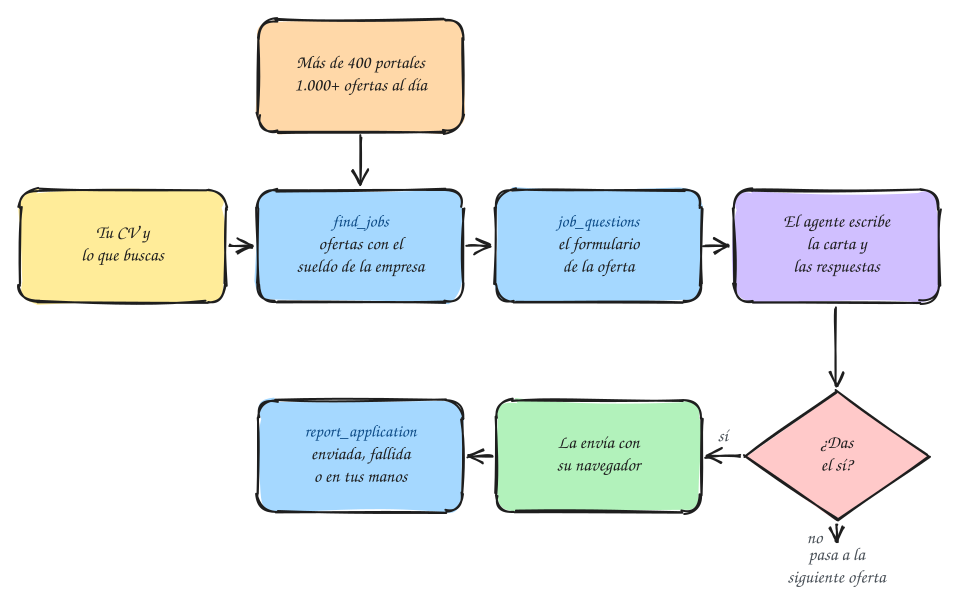

<p align="center"></p>

<h1 align="center">Aplica a miles de trabajos en tech con tu agente</h1>

<p align="center">Haz que tu agente aplique por ti. Gratis.</p>

<p align="center"><a href="https://spanishtoptechcompanies.com/es/">spanishtoptechcompanies.com</a> · <b>🇪🇸</b> / <a href="./README.en.md">🇬🇧</a></p>

<p align="center"><a href="https://github.com/pugarte7/spanish-top-tech-companies/stargazers"></a> <a href="https://github.com/pugarte7/spanish-top-tech-companies/actions/workflows/ci.yml"></a> <a href="LICENSE"></a> <a href="https://github.com/pugarte7/spanish-top-tech-companies/commits/main"></a></p>

<h3 align="center">⭐ ¿Te sirve? Dale una estrella: botón <b>Star</b>, arriba a la derecha de esta página</h3>

<p align="center">Lo mantiene una sola persona, y cada estrella hace que lo encuentre más gente que busca trabajo en España.</p>

## Conéctalo

Pega este enlace en el chat de tu agente y él se conecta solo.

```text
https://spanishtoptechcompanies.com/mcp
```

Sin registro, sin claves y sin instalar nada. Funciona con cualquier agente que admita MCP: Claude Code, Codex, Cursor, Hermes, Grok, Instinct y los demás.

## Cómo funciona

Tu agente hace el trabajo, tú decides.

1. **Conéctalo.** Un enlace en tu agente. Sin registro, sin claves y sin instalar nada.
2. **Pídele ofertas.** «Backend en remoto por encima de 60k». Busca entre las ofertas de hoy y te dice lo que paga cada empresa.
3. **Aplica con tu sí.** Rellena el formulario con tu CV, te pregunta lo que no sabe y envía solo cuando lo apruebas.

<p align="center"></p>

Para que aplique bien, dale una vez tu CV, dónde y cómo quieres trabajar, el sueldo que pides y tu permiso de trabajo. Después basta una frase:

> Aplica a 5 ofertas de backend en Barcelona.

> Aplica a las ofertas en remoto que pueda hacer desde España y que paguen 60.000 € o más.



## Preguntas frecuentes

<details>
<summary>¿Es gratis?</summary>

Sí. No hay registro, claves ni nada que instalar: es un enlace que añades a tu agente.
</details>

<details>
<summary>¿Para qué roles hay ofertas?</summary>

Para todos los que las empresas tienen abiertos: ingeniería, datos, producto, diseño, ventas, marketing y los demás.
</details>

<details>
<summary>¿De dónde salen las ofertas?</summary>

De los portales de empleo de las propias empresas, más de 400, leídos cada día: puestos en España o en remoto abiertos a España o Europa. Las que ya has visto o a las que ya has aplicado no vuelven a salir.
</details>

<details>
<summary>¿De dónde salen los sueldos?</summary>

De [Levels.fyi](https://www.levels.fyi), y solo de gente cuya ubicación está en España. Cada oferta lleva el sueldo base mediano de la empresa para ese rol y de cuánta gente sale. Las reglas están en [METHODOLOGY.md](METHODOLOGY.md#the-website-and-the-mcp-server).
</details>

<details>
<summary>¿Envía candidaturas sin preguntarme?</summary>

No. Te enseña la candidatura completa y solo la envía cuando dices que sí. Los consentimientos de privacidad los aceptas tú.
</details>

<details>
<summary>¿Se inventa respuestas?</summary>

No. Rellena con lo que dice tu CV y te pregunta lo que falta, todo en un mensaje. Las preguntas de opinión son tuyas.
</details>

<details>
<summary>¿Qué datos míos se guardan?</summary>

Ninguno. Tu CV, tus respuestas y tus candidaturas se quedan en tu agente, en su memoria o en un archivo como `~/job-search.md`. De cada llamada solo se cuenta una estadística anónima.
</details>

<details>
<summary>¿Y si mi agente no tiene navegador?</summary>

Instala uno al ir a enviar y lo usa en segundo plano, sin ventana. Solo si no puede, te da el enlace y las respuestas para que la envíes tú. Si un formulario pide un CAPTCHA, te pasa la página. Si una empresa manda un código por correo, lo lee de tu correo si se lo conectas, o te lo pide.
</details>

<details>
<summary>¿Cómo añado mi sueldo?</summary>

Súbelo a [Levels.fyi](https://www.levels.fyi/salaries/add). Es anónimo y cuenta desde la siguiente actualización, cada semana.
</details>

## Para desarrolladores

<details>
<summary>Herramientas del MCP</summary>

El servidor se llama `tech-pay-spain`. Tu agente elige la herramienta, no tienes que nombrarla.

- `find_jobs` busca entre las ofertas abiertas del día por texto, rol, región, modalidad, nivel, años de experiencia, empresa, tamaño de la empresa y sueldo mínimo. Si nada encaja, dice qué filtro sobra y propone las más cercanas.
- `job_questions` lee en directo el formulario de una oferta: cada pregunta, si es obligatoria y si la respondes tú o el agente.
- `application_guide` da el procedimiento para aplicar por alguien y la plantilla de notas que guarda el agente.
- `report_application` anota cómo fue cada solicitud y qué hizo falta para enviarla. No lleva nada sobre ti.
- `salary_stats` da el sueldo base mediano, la horquilla y el total para un rol, región y experiencia.
- `top_companies` lista las empresas que más pagan para un rol, región y experiencia.
- `company_salaries` da lo que paga una empresa, en total y por rol, región o experiencia.
- `list_filters` lista roles, regiones, tramos de experiencia y la fecha de los datos.

</details>

<details>
<summary>Servidor, datos y código</summary>

- Streamable HTTP en `https://spanishtoptechcompanies.com/mcp`, sin autenticación y con CORS abierto.
- El mismo servidor por stdio, con Node 22 o posterior y sin dependencias: `node scripts/mcp-stdio.mjs`.
- Los datos en [data.json](https://spanishtoptechcompanies.com/api/v1/data.json), las ofertas en [jobs.json](https://spanishtoptechcompanies.com/api/v1/jobs.json) y un resumen en [llms.txt](https://spanishtoptechcompanies.com/llms.txt).
- Una [skill para agentes](skills/tech-pay-spain/SKILL.md) con cómo leer las cifras.

</details>

## Contribuir

Los pull requests son bienvenidos, y un [issue](../../issues/new/choose) también si prefieres hablarlo antes.

- [CONTRIBUTING.md](CONTRIBUTING.md): cómo añadir un sueldo o una empresa y cómo abrir un pull request.
- [Código de conducta](CODE_OF_CONDUCT.md): lo que se espera de quien participa.
- [SECURITY.md](SECURITY.md): cómo avisar de un fallo de seguridad.
- [METHODOLOGY.md](METHODOLOGY.md) explica las reglas y [docs/CONTEXT.md](docs/CONTEXT.md) por qué el código es como es.

## Licencia y aviso

El código es [MIT](LICENSE) y los datos de `data/` [CC BY-SA 4.0](LICENSE-DATA). Los salarios se leen de [Levels.fyi](https://www.levels.fyi) y siguen sujetos a sus condiciones.

> Data source: Levels.fyi (https://www.levels.fyi)

Proyecto independiente, sin relación con Levels.fyi ni con ninguna de las empresas. Las cifras resumen salarios que otras personas han reportado. Pueden estar incompletas, desactualizadas o mal, y no son ofertas ni asesoramiento financiero o legal. Si quieres que se quite o corrija algo, sobre una empresa o sobre ti, abre un [issue](../../issues/new/choose) o escribe a ugartep117@gmail.com. Quién está detrás y qué datos se tratan: [aviso legal y privacidad](https://spanishtoptechcompanies.com/es/legal/).
