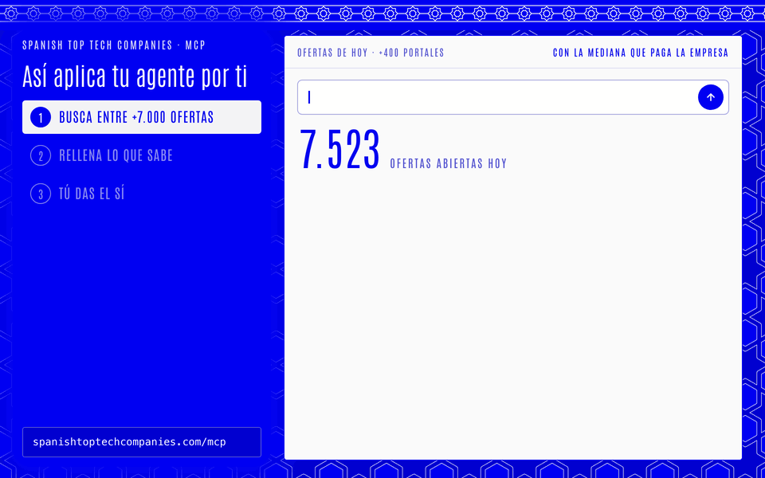
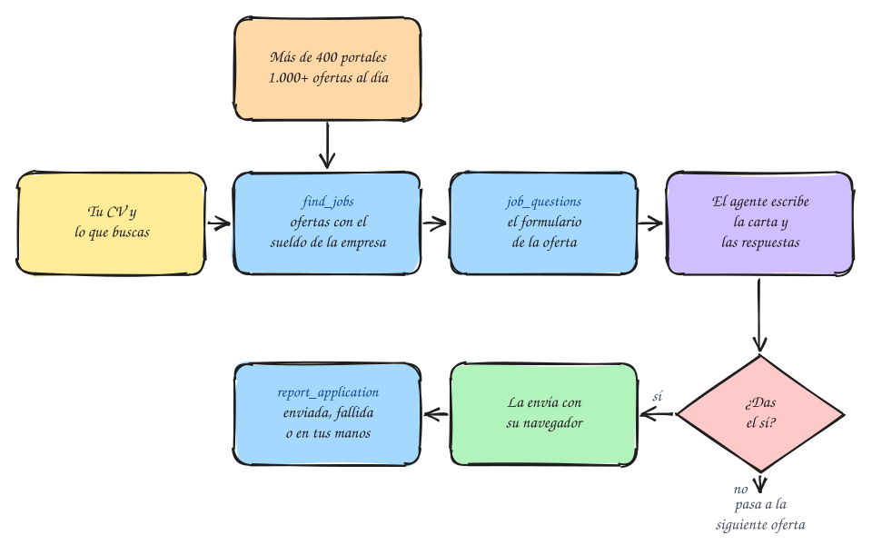

# Spanish Top Tech Companies: MCP de empleo y salarios tech en España

<div align="center"></div>

<p align="center">
🇪🇸 <a href="./README.md">Español</a> | 🇬🇧 <a href="./README.en.md">English</a>
</p>

Un servidor MCP que da a tu agente de IA los salarios reales de las empresas tech en España y sus ofertas abiertas, y aplica por ti. Cada día rastrea más de 400 portales de empleo: una media de más de 1.000 ofertas diarias a las que puedes aplicar directamente con el MCP. Detrás, una web con el ranking: **[spanishtoptechcompanies.com](https://spanishtoptechcompanies.com/es/)**.

## Contenido

- [Conecta tu agente](#conecta-tu-agente)
- [Cómo busca las ofertas](#cómo-busca-las-ofertas)
- [Aplica con tu agente](#aplica-con-tu-agente)
- [Herramientas del MCP](#herramientas-del-mcp)
- [La web](#la-web)
- [Cómo se calcula](#cómo-se-calcula)
- [Añade tu salario](#añade-tu-salario)
- [Contribuir](#contribuir)
- [Licencia](#licencia)
- [Aviso](#aviso)

## Conecta tu agente

Basta con este enlace. Añádelo como servidor MCP en tu agente, o pégaselo en el chat y que se conecte él:

```text
https://spanishtoptechcompanies.com/mcp
```

Sin registro, sin claves y sin instalar nada. Funciona con cualquier agente que admita MCP: quienes lo usan lo hacen sobre todo con Codex y Cursor, y también sirven Claude, Claude Code, Instinct o Hermes.

Es gratis y lo mantiene una sola persona. Si te sirve, deja una estrella ⭐ arriba a la derecha: es lo que hace que lo encuentre más gente que busca trabajo en España.

## Cómo busca las ofertas

Más de 400 portales de empleo, más de 1.000 ofertas al día, todas con el sueldo de la empresa al lado.

- **Rastreo diario.** Cada mañana se leen los portales de empleo públicos de las empresas de la lista: Greenhouse, Workday, Ashby, Lever, SuccessFactors, Workable, Teamtailor, SmartRecruiters, Oracle y más.
- **Solo lo que puedes hacer desde España.** Se quedan las ofertas en España y las de remoto abiertas a España o a Europa.
- **Cada oferta, leída.** Del título salen el rol y el nivel, de la descripción los años de experiencia que pide y de la ubicación la comunidad autónoma.
- **Con el sueldo al lado.** Cada oferta lleva el sueldo base mediano de la empresa para ese rol en España, y de cuánta gente sale.
- **Filtros que entienden lo que pides.** Texto con sinónimos (SRE es site reliability), rol o especialidad (backend, frontend, DevOps), región o remoto, modalidad, nivel, tus años de experiencia, empresa y sueldo mínimo. El sueldo mínimo se compara con el que publica la oferta, si lo publica, y si no con la mediana de la empresa.
- **Nunca te deja con las manos vacías.** Si nada encaja, dice cuántas ofertas quita cada filtro y propone las más cercanas.
- **Sin repetir.** Las ofertas que ya has visto o a las que ya has aplicado no vuelven a salir.
- **Aplicas desde el mismo MCP.** `job_questions` lee en directo el formulario de la oferta (Greenhouse, Lever, Ashby, Workable, Recruitee, Teamtailor, BambooHR, Pinpoint, Rippling, Eightfold y Workday con tu cuenta) y marca qué preguntas respondes tú y cuáles el agente.

## Aplica con tu agente

Tu agente busca entre esas ofertas, lee el formulario, escribe la carta y las respuestas a partir de tu CV, te enseña la solicitud completa y la envía cuando le dices que sí.



1. **Dale tu CV y lo que buscas.** Una sola vez, en el chat: tu CV, dónde y cómo quieres trabajar, el sueldo que pides y tu permiso de trabajo.
2. **Dile que aplique.** Por ejemplo:

   > Aplica por mí a las ofertas de las empresas de spanishtoptechcompanies.com que pagan 60.000 € o más a alguien con mi experiencia en Madrid.

   O: «Aplica a 5 ofertas de backend en Barcelona», «Aplica a las ofertas en remoto que pueda hacer desde España».
3. **Revisa y da el sí.** Ves cada solicitud completa antes de que salga.



> [!IMPORTANT]
> Nada se envía sin tu sí. Las preguntas delicadas, como sueldo o permiso de trabajo, te las hace una vez, todas en un mensaje, y los consentimientos de privacidad los aceptas tú.

> [!NOTE]
> La web no guarda nada tuyo. Tu perfil y tus solicitudes se quedan en tu agente, en su memoria o en un archivo como `~/job-search.md`. Si al ir a enviarla no tiene navegador, instala uno (primero un Chromium integrado, luego Claude in Chrome, luego el servidor MCP de Playwright) y lo usa en segundo plano, sin ventana, para no molestarte; solo si no puede, te da el enlace y las respuestas para que la envíes tú. Si un formulario pide un CAPTCHA, te pasa la página. Si una empresa manda un código por correo, lo lee de tu correo si se lo conectas, o te lo pide.

## Herramientas del MCP

El servidor se llama `tech-pay-spain`. Tu agente elige la herramienta; no tienes que nombrarla.

| Herramienta | Qué hace | Parámetros |
|---|---|---|
| `find_jobs` | Busca entre las más de 1.000 ofertas abiertas del día por rol, stack, sector o idioma, cada una con el sueldo base mediano de la empresa para ese rol. Si nada encaja, dice qué filtro sobra y propone las más cercanas. | `query`, `role`, `region`, `workplace`, `seniority`, `years`, `company`, `min_salary_eur`, `exclude`, `limit` |
| `job_questions` | Lee en directo el formulario de una oferta: cada pregunta, si es obligatoria y si la respondes tú o el agente, y el enlace para aplicar. | `id` |
| `application_guide` | El procedimiento para aplicar por alguien y la plantilla de notas que guarda el agente. | `client` |
| `report_application` | Cómo fue cada solicitud: enviada, incierta (se envió y nada lo confirmó), fallida y por qué, o en tus manos, y qué hizo falta para enviarla. No lleva nada sobre ti. | `id`, `status`, `reason`, `browser`, `steps`, `attempts`, `notes` |
| `salary_stats` | Sueldo base mediano, horquilla (p25-p75), total mediano y cuánta gente cobra 60.000 € o más. | `role`, `region`, `years` |
| `top_companies` | Las empresas que más pagan para un rol, región y experiencia. | `role`, `region`, `years`, `search`, `limit` |
| `company_salaries` | Lo que paga una empresa, en total y por rol, región o experiencia. | `name`, `role`, `region`, `years` |
| `list_filters` | Roles, regiones, tramos de experiencia y fecha de los datos. | |

<details>
<summary>Para desarrolladores</summary>

- Streamable HTTP en `https://spanishtoptechcompanies.com/mcp`, sin autenticación y con CORS abierto.
- El mismo servidor por stdio, con Node 22 o posterior y sin dependencias: `node scripts/mcp-stdio.mjs`.
- Los datos en [data.json](https://spanishtoptechcompanies.com/api/v1/data.json), las ofertas en [jobs.json](https://spanishtoptechcompanies.com/api/v1/jobs.json) y un resumen en [llms.txt](https://spanishtoptechcompanies.com/llms.txt).
- Una [skill para agentes](skills/tech-pay-spain/SKILL.md) con cómo leer las cifras.

</details>

## La web

[spanishtoptechcompanies.com](https://spanishtoptechcompanies.com/es/) muestra lo mismo que el MCP, para mirarlo tú:

- **Ranking de empresas tech** en España por sueldo base mediano, con buscador.
- **Salarios por rol**: ingeniería de software, producto, datos, diseño, gestión y más de 30 roles.
- **Salarios por comunidad autónoma** en un mapa.
- **Sueldo según la experiencia**, de 0 a más de 20 años.
- **Remoto, híbrido o presencial**.
- **Base y total**, con bonus y acciones.

Los salarios se actualizan cada semana y las ofertas cada día.

## Cómo se calcula

Cada salario viene de [Levels.fyi](https://www.levels.fyi) y solo cuenta si la ubicación de esa persona está en España. Aparecen todas las empresas, paguen lo que paguen, ordenadas por la mediana de su sueldo base; cada una tiene página de LinkedIn o web, y tiene en Levels.fyi al menos 5 salarios de cualquier país sumando todos los roles: una empresa que nadie más ha reportado no aparece. Las empresas con menos de 3 salarios se listan después de las demás. Los salarios se resumen por empresa, rol, región y experiencia, y los importes se redondean a 1.000 €. Los detalles están en [METHODOLOGY.md](METHODOLOGY.md#the-website-and-the-mcp-server).

## Añade tu salario

Súbelo a [Levels.fyi](https://www.levels.fyi/salaries/add). La lista se rehace con los salarios de España que hay allí, así que cuenta desde la siguiente actualización. Es anónimo. Si sabes de primera mano lo que paga una empresa, o tienes una oferta por escrito, abre un [issue](../../issues/new?template=update-band.yml).

## Contribuir

Los pull requests son bienvenidos: el pipeline, la metodología, la web, el MCP o las comprobaciones. [METHODOLOGY.md](METHODOLOGY.md) explica las reglas y [docs/CONTEXT.md](docs/CONTEXT.md) lo que ha salido mal antes y por qué el código es como es. Si quieres hablarlo antes, abre un [issue](../../issues/new/choose).

## Licencia

El código es [MIT](LICENSE) y los datos de `data/` [CC BY-SA 4.0](LICENSE-DATA). Los salarios se leen de [Levels.fyi](https://www.levels.fyi) y siguen sujetos a sus condiciones.

> Data source: Levels.fyi (https://www.levels.fyi)

## Aviso

Proyecto independiente, sin relación con Levels.fyi ni con ninguna de las empresas. Las cifras resumen salarios que otras personas han reportado. Pueden estar incompletas, desactualizadas o mal, y no son ofertas ni asesoramiento financiero o legal. Si quieres que se quite o corrija algo, sobre una empresa o sobre ti, abre un [issue](../../issues/new/choose) o escribe a ugartep117@gmail.com. Quién está detrás y qué datos se tratan: [aviso legal y privacidad](https://spanishtoptechcompanies.com/es/legal/).
